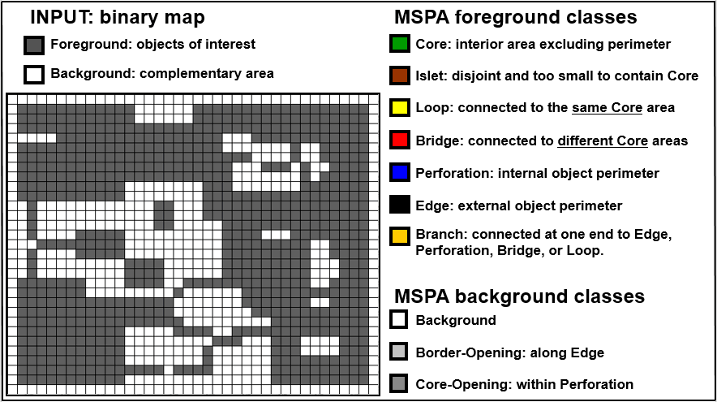
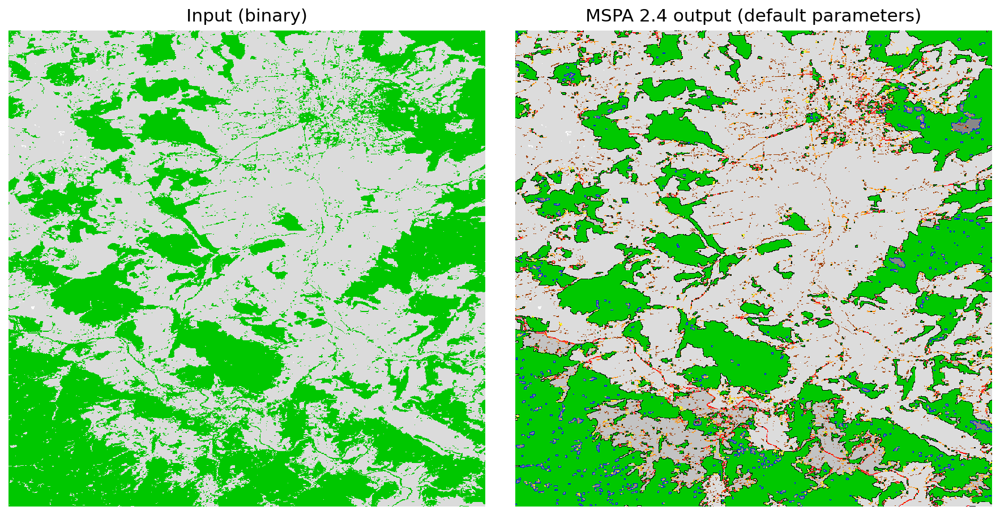

# MSPA – Morphological Spatial Pattern Analysis (standalone build)

[](https://github.com/vogtpet/MSPAstandalone/actions/workflows/build.yml)

This repository contains the complete source code and build setup needed to
compile the standalone MSPA command line tool (version 2.4) for five
operating system / CPU architecture combinations. The resulting binaries are
self-contained: they do not require a Python, GDAL, PROJ or miallib
installation on the target machine.

MSPA is a sequence of mathematical morphological operators that classifies
the foreground of a binary image into core, islet, perforation, edge, loop,
bridge, branch and background, together with transition classes.

References:

* P. Soille and P. Vogt (2009): *Morphological segmentation of binary
  patterns*. Pattern Recognition Letters 30(4):456–459.
  <https://doi.org/10.1016/j.patrec.2008.10.015>
* P. Soille and P. Vogt (2022): *Morphological Spatial Pattern Analysis:
  open source release*. ISPRS Archives XLVIII-4/W1-2022, 427–433.
  <https://doi.org/10.5194/isprs-archives-XLVIII-4-W1-2022-427-2022>

MSPA is included in the following free software packages:
[GuidosToolbox (GTB)](https://forest.jrc.ec.europa.eu/en/activities/lpa/gtb/),
[GuidosToolbox Workbench (GWB)](https://forest.jrc.ec.europa.eu/en/activities/lpa/gwb/),
and [pyGuidos](https://pyguidos-d46552.pages.code.europa.eu/index.html).
Additional information can be found on the
[MSPA homepage](https://forest.jrc.ec.europa.eu/en/activities/lpa/mspa/) and in
MSPA-related [publications](https://scholar.google.com/scholar?q=%28%22morphological+spatial+pattern+analysis%22+OR+MSPA%29+%28connectivity+OR+fragmentation%29).

The image below illustrates the MSPA segmentation procedure of a binary mask:



*Source: [JRC MSPA page](https://forest.jrc.ec.europa.eu/en/activities/lpa/mspa/).*

## Supported platforms

| Target        | Operating system            | CPU        | Toolchain                     |
|---------------|-----------------------------|------------|-------------------------------|
| `Linux`       | Linux (glibc 2.35+, built on Ubuntu 22.04) | x86_64   | GCC (distribution packages)   |
| `Linux_ARM`   | Linux (glibc 2.35+, built on Ubuntu 22.04) | aarch64  | GCC (distribution packages)   |
| `macOS_ARM`   | macOS (Apple Silicon)       | Apple Silicon | Homebrew GCC (auto-detected) |
| `Windows`     | Windows 10/11               | x86_64     | MSYS2 UCRT64 (GCC)            |
| `Windows_ARM` | Windows 11                  | ARM64      | MSYS2 CLANGARM64 (Clang)      |

The binaries are built with generic CPU tuning (no `-march=native` or other
CPU-specific instruction sets), so a binary built for `x86_64` runs on any
Intel or AMD x86_64 CPU, and a binary built for `aarch64` runs on any ARMv8-A
compatible CPU. The macOS binary is built with a minimum of **macOS 11**
(`MACOSX_DEPLOYMENT_TARGET`, default `11.0`); override it for
`source/deploy.sh macOS_ARM` if you need a different target. The build prints
the effective minimum version, which can be higher than requested when a
Homebrew library was built for a newer macOS.

## Download

Prebuilt binaries are attached to the
[releases](https://github.com/vogtpet/MSPAstandalone/releases):

| Archive | Platform |
|---|---|
| [mspa-2.4.2-linux-x86_64.tar.gz](https://github.com/vogtpet/MSPAstandalone/releases/download/v2.4.2/mspa-2.4.2-linux-x86_64.tar.gz) | Linux x86_64 (glibc 2.35+, Ubuntu 22.04 build) |
| [mspa-2.4.2-linux-x86_64-glibc2.31.tar.gz](https://github.com/vogtpet/MSPAstandalone/releases/download/v2.4.2/mspa-2.4.2-linux-x86_64-glibc2.31.tar.gz) | Linux x86_64, older glibc (Debian 11 build) |
| [mspa-2.4.2-linux-aarch64.tar.gz](https://github.com/vogtpet/MSPAstandalone/releases/download/v2.4.2/mspa-2.4.2-linux-aarch64.tar.gz) | Linux aarch64 / ARM64 (glibc 2.35+) |
| [mspa-2.4.2-macos-arm64.tar.gz](https://github.com/vogtpet/MSPAstandalone/releases/download/v2.4.2/mspa-2.4.2-macos-arm64.tar.gz) | macOS Apple Silicon |
| [mspa-2.4.2-windows-x86_64.zip](https://github.com/vogtpet/MSPAstandalone/releases/download/v2.4.2/mspa-2.4.2-windows-x86_64.zip) | Windows x86_64 |
| [mspa-2.4.2-windows-arm64.zip](https://github.com/vogtpet/MSPAstandalone/releases/download/v2.4.2/mspa-2.4.2-windows-arm64.zip) | Windows ARM64 |

Every release also includes a [`SHA256SUMS`](https://github.com/vogtpet/MSPAstandalone/releases/download/v2.4.2/SHA256SUMS) file:

```sh
sha256sum -c SHA256SUMS       # Linux
shasum -a 256 -c SHA256SUMS   # macOS
```

On Windows, check a file with `certutil -hashfile <file> SHA256`.

Every archive also contains the current `MSPA_Guide.pdf`, downloaded from the
JRC MSPA page when the release is packaged.

The `v2.4.2` release contains the optimized C implementation. The MSPA
engine is still **2.4** and the output is pixel-identical to the archived
baseline (`c-baseline-v2.4`). On a 32.5 Gpx test map the optimized code was
about 20% faster and reduced the measured peak-RAM factor from about 21× to
about 18× the uncompressed input size. The `v2.4.1` release remains available
for the previous C implementation, and the original C source is archived at
tag `c-baseline-v2.4` (see [`source/ARCHIVE.md`](source/ARCHIVE.md)).

The default Linux x86_64 binary is now built on **Ubuntu 22.04** and requires
**glibc 2.35 or newer**; this covers Ubuntu 22.04/24.04 and Debian 12/13. The
extra `...-glibc2.31.tar.gz` archive is built on Debian 11 and requires only
**glibc 2.31 or newer** for older systems. The Linux aarch64 archive is built
on Ubuntu 22.04 and requires glibc 2.35 or newer. All variants produce
identical MSPA output. For other architectures, build from source on an older
distribution; see [Building](#building).

The macOS archive contains a single, self-contained executable: `libdeflate`
and `Lerc` are linked statically, so there are no dynamic libraries to keep
next to it.

The macOS binary is ad-hoc signed and not notarised, so Gatekeeper warns about
downloaded files. After extracting the archive, clear the quarantine from the
whole folder and run it:

```sh
cd mspa-2.4.2-macos-arm64
xattr -cr .
./mspa_macOS_ARM -help
```

Clearing the executable is enough; there are no bundled libraries. Only a
Developer ID signature plus Apple notarisation avoids the warning entirely.

The Windows binaries are not code-signed, so SmartScreen may show a warning;
choose “More info” → “Run anyway” after verifying the checksum.

## Command line

```
mspa -i <input> [-o <output>] [-odir <dir>] [-eew <width>]
     [-graphfg <4|8>] [-internal <0|1>] [-transition <0|1>] [-disk]
     [-v] [-help|-usage]
```

| Option        | Meaning                                                        | Default     |
|---------------|----------------------------------------------------------------|-------------|
| `-i <file>`   | input image (binary or grey level, TIFF or other miallib format) | required  |
| `-o <file>`   | output image                                                   | `out.tif`   |
| `-odir <dir>` | output directory                                               | `./`        |
| `-eew <n>`    | effective edge width                                           | `1.0`       |
| `-graphfg <n>`| foreground connectivity (4 or 8)                               | `8`         |
| `-internal <n>` | include internal holes/disconnected foreground (0/1)         | `1`         |
| `-transition <n>` | include transition classes (0/1)                           | `1`         |
| `-disk`       | minimum RAM mode: spool intermediate images to disk            | off         |
| `-v`          | verbose parameter output                                       | off         |

Output pixel values follow the MSPA colour code (MSPA guide, page 6):

| Class | Internal = 0 | Internal = 1 |
|---|---|---|
| Core | 17 | 17, 117 |
| Islet | 9 | 9, 109 |
| Perforation | 5 | 105 |
| Edge | 3 | 3, 103 |
| Loop | 65 | 65, 165 |
| Loop in edge | 67 | 67, 167 |
| Loop in perforation | 69 | 169 |
| Bridge | 33 | 33, 133 |
| Bridge in edge | 35 | 35, 135 |
| Bridge in perforation | 37 | 137 |
| Branch | 1 | 1, 101 |
| Background | 0 | 0 |
| Border-Opening | – | 220 |
| Core-Opening | – | 100 |
| No Data | 129 | 129 |

With `-internal 1` the pixel values of internal features are offset by 100
(for example 17 → 117). Value 255 is not used by MSPA.

## Example

A minimal run on the binary test image:

```sh
mspa -i source/testing/input.tif -o output.tif -odir source/testing
```

The left panel shows the binary input (`source/testing/input.tif`); the right panel
shows the MSPA output produced with the default parameters. The colours follow
the MSPA class codes listed above.



## Tested on

* **Linux x86_64** – built on Ubuntu 22.04; the Debian 11 build (glibc 2.31)
  was tested on Debian, Ubuntu, Fedora and openSUSE
* **Linux aarch64** – Ubuntu 22.04 (native and CI)
* **macOS ARM64** – Apple Silicon with Homebrew GCC
* **Windows x86_64** – Windows 10/11 with MSYS2 UCRT64
* **Windows ARM64** – Windows 11 with MSYS2 CLANGARM64

All five targets produce pixel-identical output for `source/testing/input.tif`; the
`source/deploy.sh` smoke test and the CI matrix verify this automatically.

## Repository layout

```
source/                 all files needed to build and test MSPA
  Makefile_Linux        driver makefiles (one per target)
  Makefile_Linux_ARM
  Makefile_macOS_ARM
  Makefile_Windows
  Makefile_Windows_ARM
  deploy.sh             builds the library, the binary and the distribution
  ARCHIVE.md            archived original C implementation (tag c-baseline-v2.4)
  corridor_lightmemt.c  MSPA driver (legacy name; referred to as fsp.c)
  frag.c / frag.h       command line handling
  mia_parse.c / .h      generic argument parser
  ReadmeCompile.docx    detailed build instructions (Word document)
  mial-master/          miallib source code and public headers
                        (the driver includes them directly; see
                        "Upstream modifications")
  testing/              smoke test image, reference outputs and comparison tool
python/                 alternative pure-Python MSPA implementation
  mspa/                 engine (no compiled binary required)
  preflight.py          hardware/RAM feasibility, memmap and runtime estimate
  run_mspa.py           command-line wrapper with the preflight guard
  run_mspa.sh/.bat      launchers that use the project venv automatically
  mspa/workspace.py     RAM or memory-mapped array allocator
  mspa/palettes.py      official transition 0/1 MSPA colour tables
  test_parity.py        pixel comparison against the source/testing references
docs/example.png        example figure used in the README
docs/mspa_procedure.gif MSPA segmentation procedure animation (JRC)
.github/workflows/      CI build matrix (five targets)
CITATION.cff            machine-readable citation metadata
RELEASE.md              release checklist
packaging/              release packaging script
LICENSE                 GNU General Public License v3
```

## Building

All targets are built with a single script. The script has to be run from a
bash shell (Linux, macOS, MSYS2) and needs `make`, a C compiler and the
platform libraries listed below. It refuses to build a target that does not
match the host operating system and CPU architecture, because the makefiles
do not cross-compile. The compiler can be overridden with `MSPA_CC=<compiler>`;
on macOS the installed Homebrew GCC is detected automatically.

All files needed to build and test MSPA are in [`source/`](source/) — the makefiles, driver sources, miallib, `deploy.sh` and the detailed build document.

### Linux x86_64 and Linux aarch64

Use Ubuntu 22.04 (glibc 2.35) for the portable release build, or Debian 11
(glibc 2.31) for the widest compatibility.  The static libraries needed for
linking are available as distribution packages:

```sh
sudo apt update
sudo apt install build-essential gcc g++ make libgomp1 \
    libtiff-dev libdeflate-dev libpng-dev libwebp-dev libjpeg-dev \
    libjbig-dev liblerc-dev libzstd-dev \
    liblzma-dev zlib1g-dev
```

`libsharpyuv-dev` is optional.  The makefiles link it automatically when it
is present; Ubuntu 22.04 and Debian 11 do not ship a separate static
`libsharpyuv` and the build works without it.

Then run one of:

```sh
./source/deploy.sh Linux
./source/deploy.sh Linux_ARM
```

The Linux binaries are dynamically linked against the system C library. The
official release is built on Ubuntu 22.04 (glibc 2.35) and runs on
distributions with glibc 2.35 or newer; the Debian 11 compatibility build
requires only glibc 2.31. Build on an older distribution if you need to
support even older systems.

### MS-Windows x86_64 (MSYS2 UCRT64)

Install [MSYS2](https://www.msys2.org/), open the **UCRT64** terminal and run:

```sh
pacman -Syu
pacman -S --needed base-devel \
    mingw-w64-ucrt-x86_64-toolchain mingw-w64-ucrt-x86_64-gcc \
    mingw-w64-ucrt-x86_64-gcc-libs mingw-w64-ucrt-x86_64-make \
    mingw-w64-ucrt-x86_64-libpng mingw-w64-ucrt-x86_64-libwebp \
    mingw-w64-ucrt-x86_64-libjpeg-turbo mingw-w64-ucrt-x86_64-jbigkit \
    mingw-w64-ucrt-x86_64-lerc \
    mingw-w64-ucrt-x86_64-zstd mingw-w64-ucrt-x86_64-xz \
    mingw-w64-ucrt-x86_64-zlib mingw-w64-ucrt-x86_64-libtiff \
    mingw-w64-ucrt-x86_64-libdeflate
```

Copy the repository into your MSYS2 home directory
(`C:\msys64\home\<user>\`), change into it and run:

```sh
./source/deploy.sh Windows
```

### MS-Windows ARM64 (MSYS2 CLANGARM64)

Install [MSYS2](https://www.msys2.org/) with the CLANGARM64 environment, open
the **CLANGARM64** terminal and run:

```sh
pacman -Syu
pacman -S --needed \
    mingw-w64-clang-aarch64-clang mingw-w64-clang-aarch64-llvm-openmp \
    mingw-w64-clang-aarch64-toolchain mingw-w64-clang-aarch64-gcc-compat \
    mingw-w64-clang-aarch64-libtiff mingw-w64-clang-aarch64-libpng \
    mingw-w64-clang-aarch64-libwebp mingw-w64-clang-aarch64-libjpeg-turbo \
    mingw-w64-clang-aarch64-jbigkit mingw-w64-clang-aarch64-lerc \
    mingw-w64-clang-aarch64-zstd mingw-w64-clang-aarch64-xz \
    mingw-w64-clang-aarch64-zlib mingw-w64-clang-aarch64-libdeflate \
    make git
```

Then run:

```sh
./source/deploy.sh Windows_ARM
```

### macOS (Apple Silicon)

Install [Homebrew](https://brew.sh/) and the required packages:

```sh
brew install gcc liblerc libdeflate libtiff jpeg-turbo \
    libpng webp jbigkit zstd xz
```

Then run:

```sh
./source/deploy.sh macOS_ARM
```

The installed Homebrew GCC is detected automatically (the newest version if
several are installed), so the build keeps working after a GCC upgrade. To
select a specific compiler, set `MSPA_CC`:

```sh
MSPA_CC=/opt/homebrew/bin/gcc-15 ./source/deploy.sh macOS_ARM
```

When the codecs are linked dynamically (the default for a local build),
`source/deploy.sh` bundles `libdeflate` and `libLerc` and rewrites their paths
to `@executable_path`. The release build sets `MSPA_DEFLATE_A` and
`MSPA_LERC_A` to static libraries built with
`CMAKE_OSX_DEPLOYMENT_TARGET=11.0`, so the binary is self-contained.

## What `source/deploy.sh` does

1. checks that the requested target matches the host OS and CPU architecture;
2. builds the static library `libmiallib_mspa.a` from `source/mial-master/core/c`;
3. compiles the MSPA driver with the platform makefile;
4. creates `source/mspa_dist_<target>/` and copies the executable;
5. on macOS, bundles and re-signs dynamic libraries when the codecs are
   linked dynamically;
6. runs the test image `source/testing/input.tif` twice (default parameters and
   `-graphfg 4 -internal 0`) and compares both outputs pixel by pixel with
   the reference images;
7. removes the intermediate object files and the static library.

If any step fails, the script stops with a non-zero exit status.

## Testing

`source/deploy.sh` runs two test cases and compares both results pixel by pixel with
the reference images in `source/testing/`:

```sh
./source/deploy.sh macOS_ARM
# ... builds and runs:
#   mspa -i input.tif -o output.tif -odir ./
#   mspa -i input.tif -o output_nondefault.tif -odir ./ -graphfg 4 -internal 0
# ... then verifies output*.tif against source/testing/reference*.tif
```

The comparison uses `source/testing/tiffcmp.c`, a small tool built against libtiff
(no Python, GDAL or ImageMagick needed). It fails the build if a single pixel
differs. Set `MSPA_SKIP_VERIFY=1` to skip this check, for example while
experimenting with a modified algorithm.

The TIFF output contains a `Software` tag and a timestamp, so two runs are not
byte-identical; only the pixel values are compared. `source/testing/compare_outputs.py`
is an alternative comparison script (requires Pillow), and
`source/testing/README.md` lists the expected class counts for the test image.

## Python implementation (alternative)

[`python/`](python/) contains a pure-Python port of MSPA. It is an alternative
for environments where a compiled binary cannot be shipped (for example a QGIS
plugin), not a replacement for the C build. The Python engine produces
pixel-identical results to the C reference images in `source/testing/` for the
default and `-graphfg 4 -internal 0` runs at edge widths 1.0 and 5.0. A wider
comparison against the compiled C binary (edge widths 1–10, both connectivities,
internal/transition on and off, and synthetic rasters) was also pixel-identical.

```sh
cd python
./run_mspa.sh -i map.tif -o output.tif
```

On first use the launcher creates `.venv` and installs `requirements.txt`
automatically (Python 3.10-3.14; Numba 0.68 provides the Python 3.14 wheels,
except on Intel macOS).

The wrapper runs the preflight automatically and refuses to start if the map
is not expected to fit. You can also run `preflight.py` separately and use
`test_parity.py` to check the reference output.

`preflight.py` checks the CPU count, available RAM, the input dimensions from
the header, and optionally a memory-mapped temp directory; it exits non-zero
if neither the in-memory nor the memmap mode is likely to fit. See
[`python/preflight.py`](python/preflight.py).

See [`python/README.md`](python/README.md) for usage and the class-code table.
The Python engine remains an alternative, but since `v2.4.2` the optimized C
binary is faster and uses less memory on large maps.  The older
Python-vs-C benchmark table in `python/README.md` predates the C
optimization.

## Continuous integration

[`.github/workflows/build.yml`](.github/workflows/build.yml) builds and tests
all five targets on GitHub-hosted runners and uploads each distribution
directory as a workflow artifact:

| Job | Runner |
|-----|--------|
| `Linux` | `ubuntu-22.04` |
| `Linux_ARM` | `ubuntu-24.04-arm` |
| `Windows` | `windows-2025` (MSYS2 UCRT64) |
| `Windows_ARM` | `windows-11-arm` (MSYS2 CLANGARM64) |
| `macOS_ARM` | `macos-15` (Apple Silicon) |

All ARM jobs run natively, so the CI results are not affected by emulation.

## Citation

If you use MSPA in a publication, please cite:

* P. Soille and P. Vogt (2009): *Morphological segmentation of binary
  patterns*. Pattern Recognition Letters 30(4):456–459.
  <https://doi.org/10.1016/j.patrec.2008.10.015>
* P. Soille and P. Vogt (2022): *Morphological Spatial Pattern Analysis:
  open source release*. The International Archives of the Photogrammetry,
  Remote Sensing and Spatial Information Sciences, XLVIII-4/W1-2022, 427–433.
  <https://doi.org/10.5194/isprs-archives-XLVIII-4-W1-2022-427-2022>

```bibtex
@article{soille2009morphological,
  author  = {Soille, Pierre and Vogt, Peter},
  title   = {Morphological segmentation of binary patterns},
  journal = {Pattern Recognition Letters},
  volume  = {30},
  number  = {4},
  pages   = {456--459},
  year    = {2009},
  doi     = {10.1016/j.patrec.2008.10.015}
}

@article{soille2022morphological,
  author  = {Soille, Pierre and Vogt, Peter},
  title   = {Morphological Spatial Pattern Analysis: open source release},
  journal = {The International Archives of the Photogrammetry, Remote Sensing and Spatial Information Sciences},
  volume  = {XLVIII-4/W1-2022},
  pages   = {427--433},
  year    = {2022},
  doi     = {10.5194/isprs-archives-XLVIII-4-W1-2022-427-2022}
}
```

A machine-readable version is available in [`CITATION.cff`](CITATION.cff).

## License

MSPA and miallib are free software: you can redistribute them and/or modify
them under the terms of the **GNU General Public License, version 3 or later**
(GPL-3.0-or-later). See [LICENSE](LICENSE) for the full text.

This program is distributed in the hope that it will be useful, but WITHOUT
ANY WARRANTY; without even the implied warranty of MERCHANTABILITY or FITNESS
FOR A PARTICULAR PURPOSE.

## Third-party components

The binaries link the following libraries. Their licences are compatible with
the GPL; the upstream notices are retained in `source/mial-master/` and in the
respective library packages.

* miallib (JRC, GPL-3.0-or-later) – image processing library
* libtiff (libtiff licence), libjpeg-turbo (BSD/IJG), libpng (libpng licence),
  libwebp (BSD), jbigkit (GPL-2.0-or-later), zlib (zlib licence), zstd (BSD/GPL-2.0),
  xz/liblzma (public domain), libdeflate (MIT), Lerc (Apache-2.0)

## Upstream modifications

The source code of MSPAstandalone (`source/`) is based on a snapshot of the JRC
sources [miallib](https://github.com/ec-jrc/jeolib-miallib). The upstream code
was written for Linux x86_64. The following changes make the same source tree
compile and run on Windows and macOS, on x86_64 and aarch64:

* the build system detects the target architecture and the compiler
  (GCC/Clang) and uses the matching OpenMP flags;
* the FIFO used by the connected-component labelling stores pointers in
  `intptr_t` instead of `long int`, which is 32 bit on 64 bit Windows;
* the makefile builds only the subset of miallib needed by MSPA and no longer
  depends on GDAL, PROJ or FFTW;
* the `FSP` build flag is passed to the library so that the MSPA-specific
  TIFF software tag and input handling remain unchanged.

The exact list of modified files is in
[`source/mial-master/MODIFICATIONS.md`](source/mial-master/MODIFICATIONS.md).

## Documentation

`source/ReadmeCompile.docx` contains the detailed, illustrated build instructions for
all supported platforms. This README is the quick reference.
